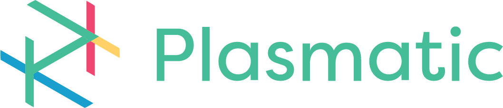

<div class="hero-logo">
    
</div>

# Reframe - A Universal Transformation Engine

**Reframe** is a high-performance, open-source rules engine for transforming any message format. Convert between SWIFT MT, ISO 20022, or custom formats using auditable JSONLogic rules.

**[Try the Interactive Playground →](./playground/index.md)**

---

## Universal Transformation Engine

Reframe transforms any message format using auditable rules:

- **SWIFT MT ↔ ISO 20022**: Free CBPR+ package included
- **Custom formats**: Any format with JSONLogic transformation rules

```bash
# Quick start with Docker
docker pull ghcr.io/goplasmatic/reframe:latest
docker run -p 3000:3000 ghcr.io/goplasmatic/reframe:latest
```

---

## Architecture

Reframe separates the transformation engine from business rules via packages. The engine handles parsing, rule evaluation, and validation - while packages contain the actual transformation logic.

**[Learn About the Architecture →](./why-reframe/architecture-overview.md)**

---

## Why Choose Reframe?

### Open Source Rules Engine
All transformation rules are externalized in auditable JSONLogic files. Inspect, modify, and extend any mapping logic. Apache 2.0 licensed.

### High Performance
Built in Rust with sub-millisecond transformation latency. Process thousands of messages per second.

### Standards Agnostic
Load the SWIFT CBPR+ package or create your own for proprietary formats.

### Enterprise Ready
Hot-reload, GraphQL API, custom fields, and full audit trails. Deploy as a single Docker container.

---

## Featured Package: SWIFT CBPR+ ISO 20022

Free, SR2025-compliant transformation package with **41+ scenarios**:

| Category | Transformations |
|----------|-----------------|
| **Customer Payments** | MT103 ↔ pacs.008 |
| **FI Transfers** | MT202 ↔ pacs.009 |
| **Statements** | MT940 ↔ camt.053 |

**[View Complete Message Catalog →](./cbpr-plus/message-catalog.md)**

---

## Powered By Open Source

Reframe is built on a foundation of specialized open-source libraries:

| Library | Purpose | Links |
|---------|---------|-------|
| **Datalogic** | JSONLogic rule evaluation | [Docs](https://goplasmatic.github.io/datalogic-rs/) · [GitHub](https://github.com/GoPlasmatic/datalogic-rs) |
| **Dataflow** | Workflow orchestration | [Docs](https://goplasmatic.github.io/dataflow-rs/) · [GitHub](https://github.com/GoPlasmatic/dataflow-rs) |
| **Datafake** | Test data generation | [Docs](https://goplasmatic.github.io/datafake-rs/) · [GitHub](https://github.com/GoPlasmatic/datafake-rs) |

Each library has its own interactive playground for testing and learning.

---

## Quick Comparison

| Feature | Reframe (Open Source) | Proprietary Solutions |
|---------|----------------------|----------------------|
| **License** | Apache 2.0 (Free) | Expensive licensing |
| **Rules** | Auditable JSONLogic | Black-box logic |
| **Standards** | Universal (packages) | Limited scope |
| **Performance** | Sub-millisecond (Rust) | Slower (JVM) |
| **Updates** | Hot-reload rules | Vendor intervention |

---

## Get Started

<div class="cta-buttons">

**[Try the Playground](./playground/index.md)** - Test transformations instantly

**[Quick Start Guide](./getting-started/quick-start.md)** - Run Reframe in 5 minutes

**[CBPR+ Package Guide](./cbpr-plus/overview.md)** - Explore ISO 20022 transformations

</div>

---

## Resources

- **GitHub**: [github.com/GoPlasmatic/Reframe](https://github.com/GoPlasmatic/Reframe)
- **CBPR+ Package**: [github.com/GoPlasmatic/reframe-package-swift-cbpr](https://github.com/GoPlasmatic/reframe-package-swift-cbpr)
- **License**: [Apache License 2.0](https://github.com/GoPlasmatic/Reframe/blob/main/LICENSE)

---

*Built by [Plasmatic](https://github.com/GoPlasmatic) - Making message transformation transparent, fast, and reliable.*
